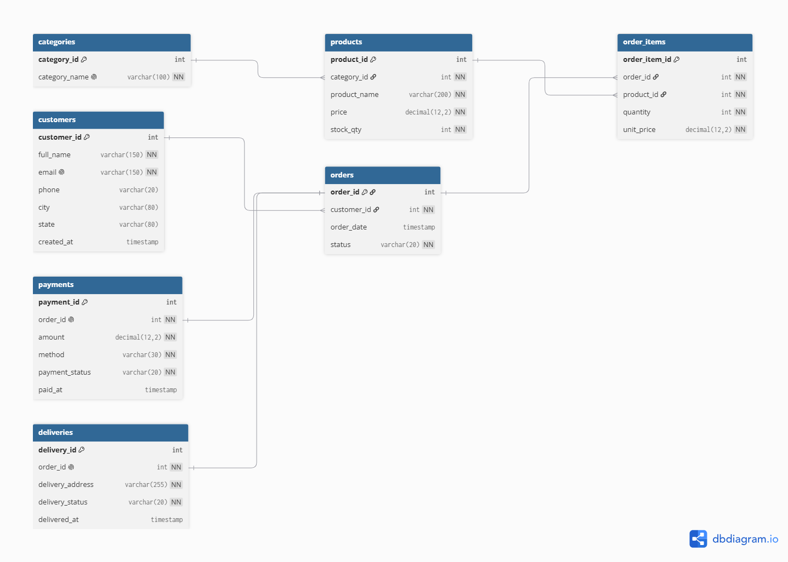

# Portfolio 1: Database Design and Modelling

## Case study
Kasuwa Express, a fictional Nigerian online store (see the main README).

## Files in this folder
- er-diagram.png: the Entity Relationship (ER) diagram
- er-diagram.dbml: the source code used to draw the diagram on dbdiagram.io
- schema.sql: the CREATE TABLE script (relational schema)
- sample_data.sql: test data inserted into the tables
- screenshots/: evidence that the database was created and works

## ER diagram

## Relational schema
The database has seven tables: categories, customers, products, orders,
order_items, payments and deliveries.

Keys and relationships:
- Every table has a primary key (for example customer_id) that uniquely
  identifies each row.
- Foreign keys link the tables: products.category_id points to categories,
  orders.customer_id points to customers, and order_items links orders to
  products.
- One customer can place many orders (one-to-many).
- An order can contain many products, and a product can appear in many
  orders. This many-to-many relationship is handled by the order_items table.
- Each order has one payment and one delivery (one-to-one).

Constraints used:
- NOT NULL: required fields cannot be empty.
- UNIQUE: no two customers can have the same email.
- CHECK: price must be above 0, stock cannot be negative, quantity must be
  above 0, and order status and payment method must be from a fixed list.
- REFERENCES (foreign keys): prevent an order for a customer or product that
  does not exist.

## Normalisation
Normalisation means organising data so that each fact is stored once. If I
had used a single big table with the customer's name, phone, product names,
prices and payment details repeated on every order row, then changing a
product's price or a customer's phone number would mean editing many rows,
and mistakes would be easy to make.

- First Normal Form (1NF): every column holds a single value and there are
  no repeating groups. An order with several products is not stored in one
  row; each product is a separate row in order_items.
- Second Normal Form (2NF): every non-key column depends on the whole key.
  Product details such as name and price depend only on product_id, so they
  are stored in products, not in order_items.
- Third Normal Form (3NF): no non-key column depends on another non-key
  column. A product's category name depends on category_id, not on the
  product, so category names are stored once in categories.

Design decisions:
- unit_price is stored in order_items on purpose. It records the price at
  the time of purchase, so later price changes do not alter past orders.
- delivery_address is stored in deliveries because a customer may ship an
  order to a different address from their usual one.
- city and state are kept in customers for simplicity. The same city name
  can exist in different states, so a city alone does not decide the state.

## Testing and evidence
I created the database in PostgreSQL using pgAdmin, ran schema.sql, then ran
sample_data.sql. I confirmed the tables exist and contain data using SELECT
queries.

## Challenges and what I learned
It's my first time designing and creating a database and I've loved the expereince so far.
I had Gemini AI breakdown the assignment steps to me and guide me through the required steps,
I also watched some youtube tutorials to understand better. My favorite part was deigning and drawing the diagram design for the database, and setting up the github. However it wasn't without challenge, navigating the pgadmin4 interface and setting it up was very challenging, but I triumphed eventually and here we are.