# Portfolio 2: Query Processing and Optimisation

## Case study
Kasuwa Express, a fictional Nigerian online store (see the main README).

## Files in this folder
- bulk_data.sql: generates about 20,000 customers and 100,000 orders so that
  query performance can be measured
- queries.sql: the report queries and the indexes I created
- screenshots/: query results and execution plans

## Test data
The small sample from Portfolio 1 was too small to show performance
differences, so I generated more data. Row counts: [FILL IN the numbers from
screenshot 01].

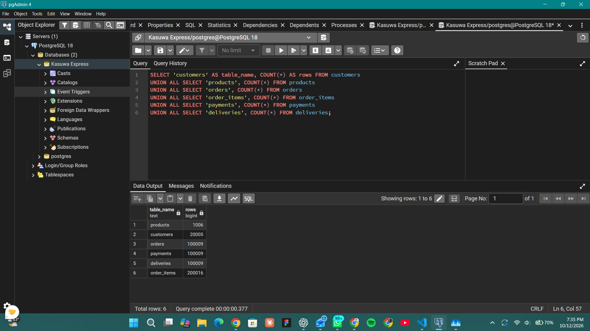

## SQL queries and results
1. Top 10 customers by money spent: joins customers, orders and order_items,
   filters out cancelled or unpaid orders, groups by customer and sorts by
   total spent.
2. Best-selling products: joins order_items, products, categories and orders,
   sums the quantity sold per product.
3. Sales per state: groups revenue by the customer's state.

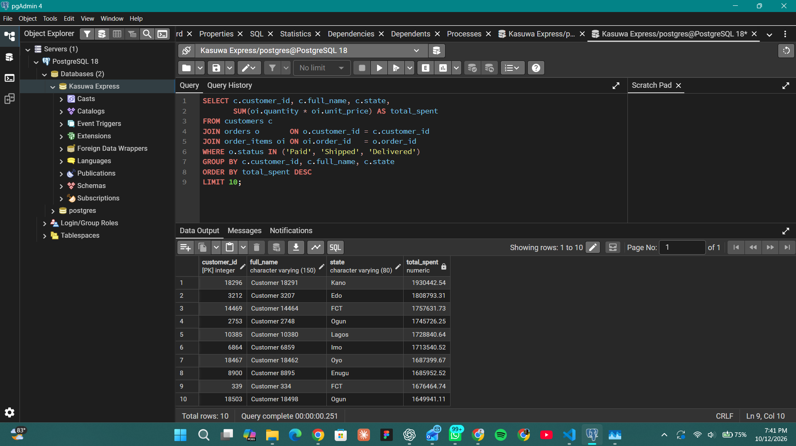
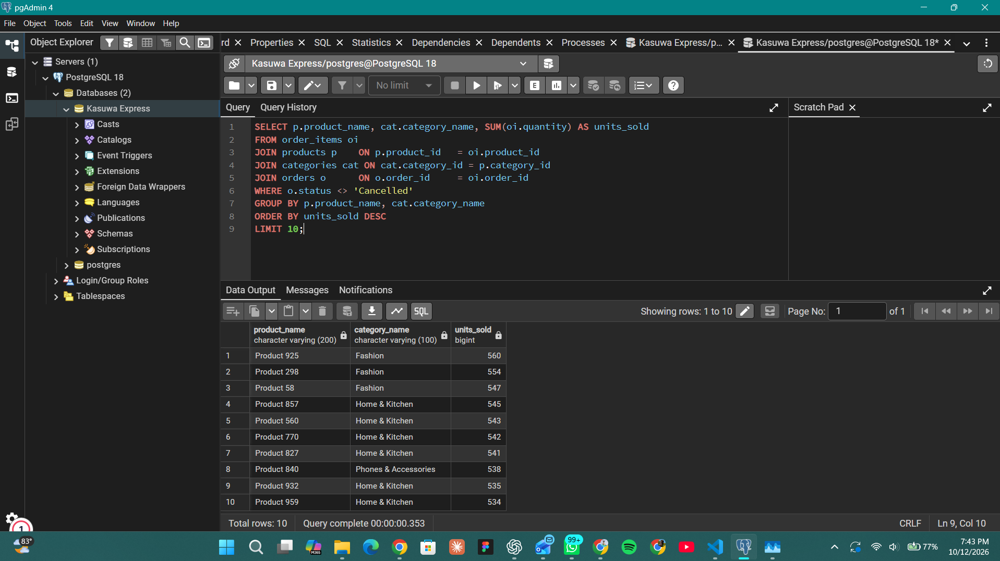
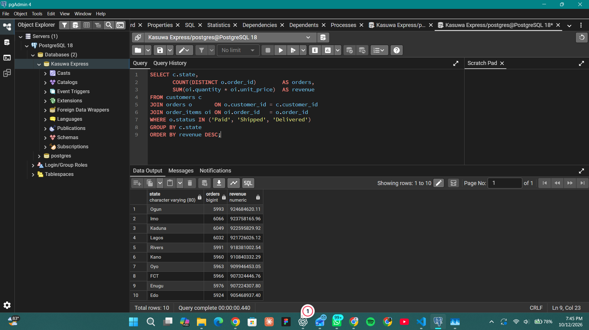

## Execution plans and indexing

I used EXPLAIN ANALYZE to see how PostgreSQL runs a query.

### Experiment 1: finding one customer's orders
Query: SELECT * FROM orders WHERE customer_id = 12345;

- Before the index, the plan used 4.286 and took 6.513 ms.
- I created the index idx_orders_customer_id on orders(customer_id).
- After the index, the plan used 0.069 and took
  0.474 ms.

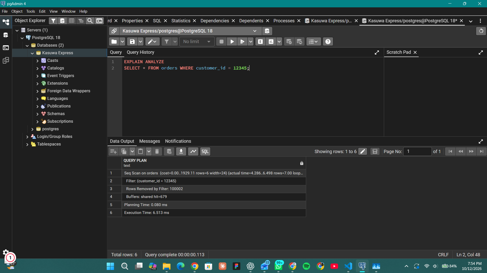
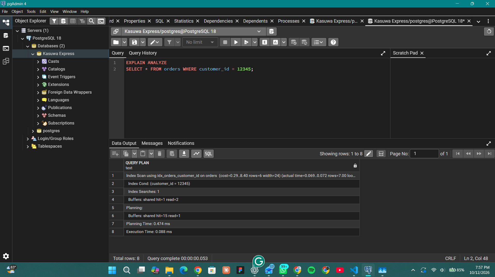

### Experiment 2: finding the items in one order
Query: SELECT * FROM order_items WHERE order_id = 50000;

- Before the index: 8.607 and 14.530 ms.
- After creating idx_order_items_order_id: 0.0047 and 0.206 ms.

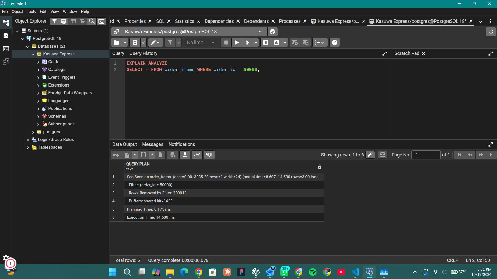
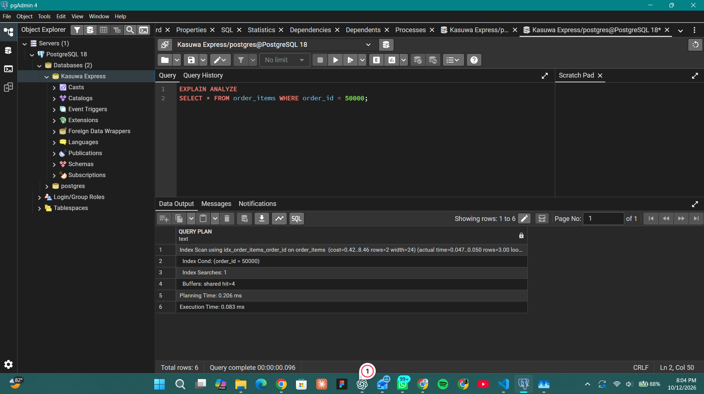

### A larger query
The top-customers query joins three tables. Its plan uses a Seq Scan on each
of the three tables (order_items, orders and customers), two Hash Joins to
combine them, a HashAggregate to add up each customer's spending, and a
top-N heapsort to keep only the 10 biggest spenders. Execution time was
201.934 ms. The plan is long, so it is shown in three screenshots.

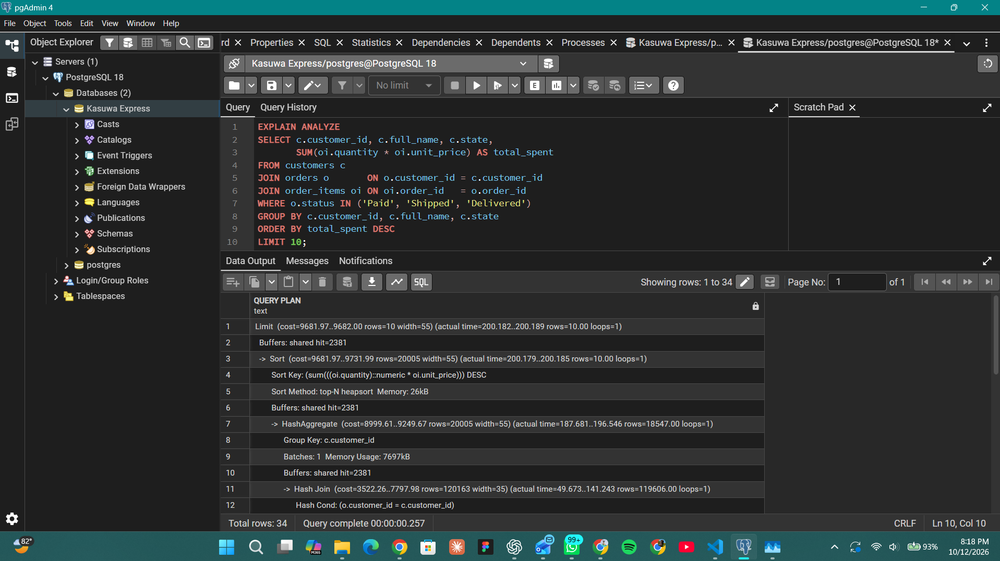
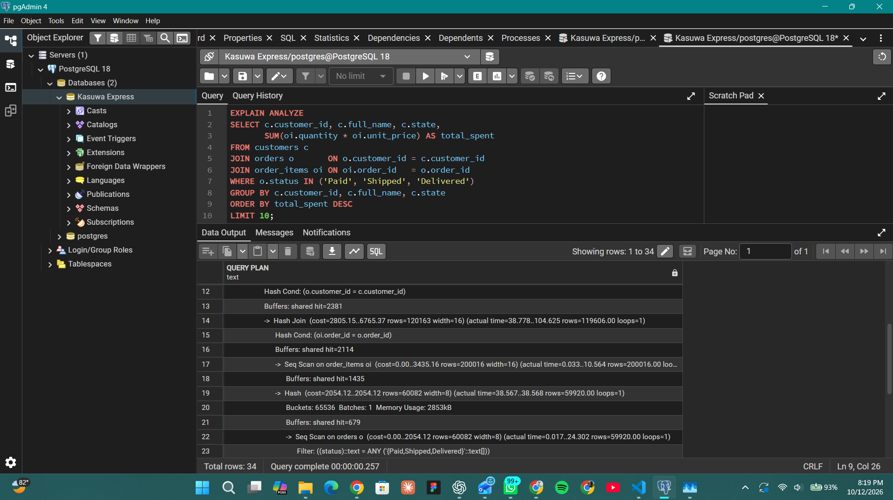
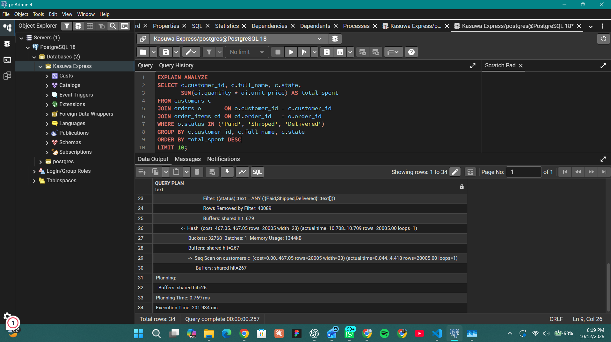

### Summary table
| Query | Plan before | Time before | Plan after | Time after |
|---|---|---|---|---|
| Orders for one customer | Seq Scan on orders | 6.513 ms | Index Scan using idx_orders_customer_id | 0.088 ms |
| Items in one order | Seq Scan on order_items | 14.530 ms | Index Scan using idx_order_items_order_id | 0.083 ms |

## Performance analysis
A sequential scan makes PostgreSQL read every row of a table to find the
matches. With about 100,000 orders this is slow, and it gets worse as the
table grows. An index is a separate sorted structure, like the index of a
book, that lets the database jump directly to the matching rows. In my tests, finding one customer's orders dropped from 6.513 ms to 0.088 ms
(about 74 times faster), and finding the items in one order dropped from
14.530 ms to 0.083 ms (about 175 times faster).

PostgreSQL does not automatically create an index on a foreign key column
such as orders.customer_id, which is why those queries were slow until I
added one.

Indexes are not free: they use extra disk space and make INSERT, UPDATE and
DELETE slightly slower because the index must be kept up to date. For that
reason I only indexed columns that are searched or joined often. Reports that
must read most of a table, such as sales per state, gain little from an index
because they need nearly all the rows anyway. 
My top-customers plan confirms this: it still used Seq Scans on all three
tables, because the query needs most of the rows in them anyway.

