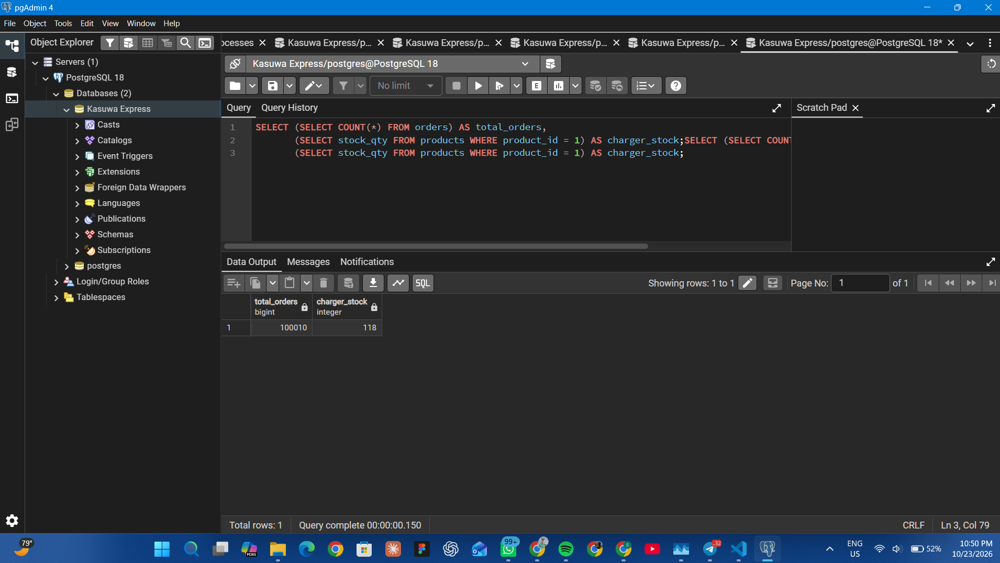
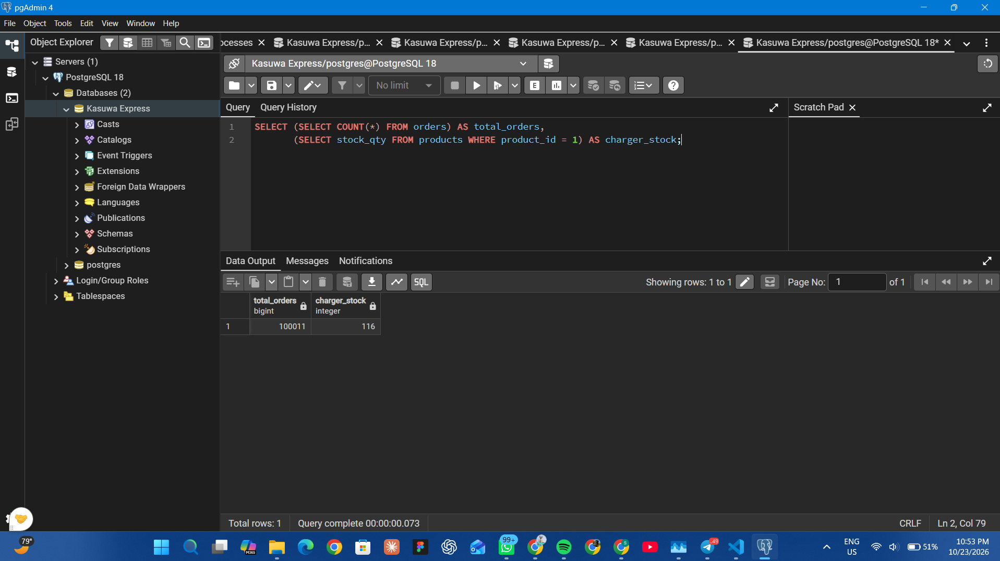
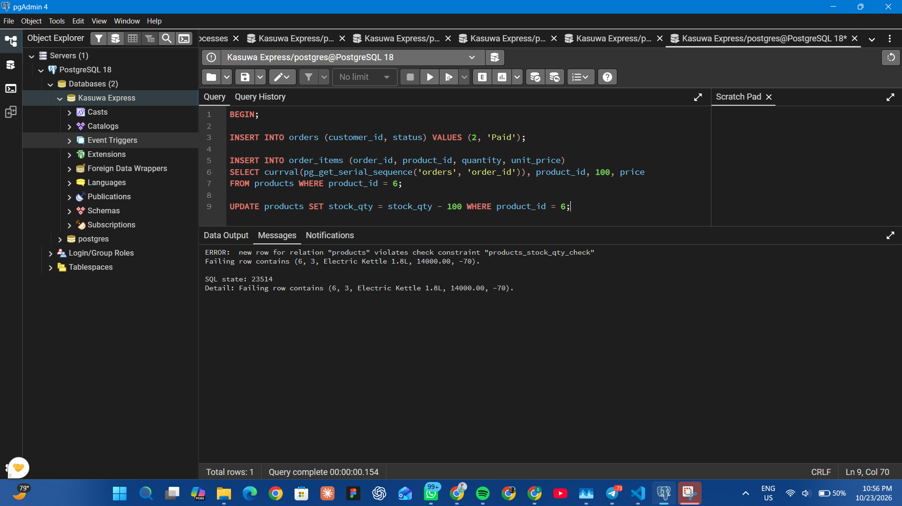
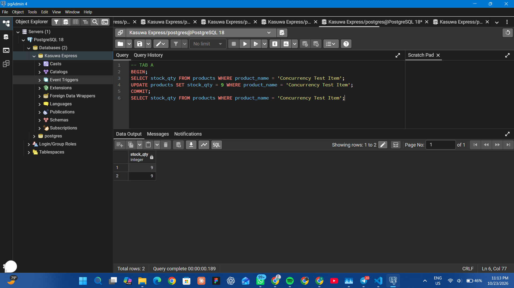
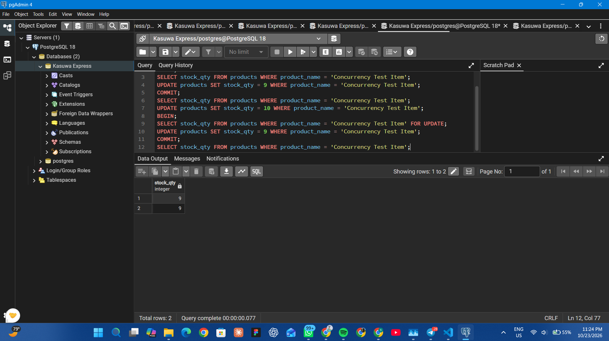
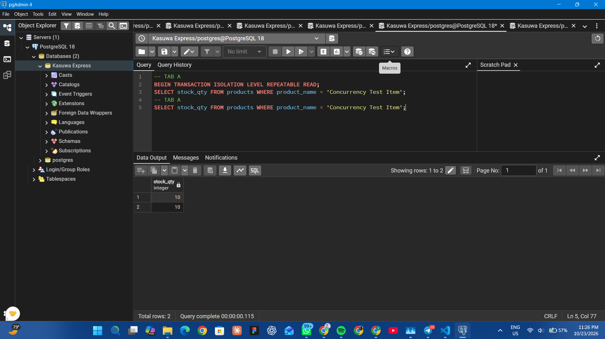

# Portfolio 3: Transactions and Concurrency

## Case study
Kasuwa Express, a fictional Nigerian online store (see the main README).

## Files in this folder
- transactions.sql: all the transaction and concurrency statements
- screenshots/: evidence of each experiment

## Key ideas
A transaction groups several steps so that they either all succeed or all
fail. Databases follow the ACID properties:
- Atomicity: all steps of a transaction happen, or none of them do.
- Consistency: the database rules (such as stock never below zero) always hold.
- Isolation: transactions running at the same time do not corrupt each other.
- Durability: once a transaction is committed, the data is saved permanently.

## Experiment 1: successful order (COMMIT)
Placing an order needs five steps: create the order, add the order item,
reduce the stock, record the payment and create the delivery. I ran them all
in one transaction that ended with COMMIT.

- Before: 100010 orders in total, charger stock 118.
- After: 100011 orders in total, charger stock 116.

## Experiment 2: failed order (ROLLBACK)
A customer tried to order 100 electric kettles, but the shop only had a small
number in stock. The stock update was rejected by the CHECK constraint
(stock cannot be negative). I then ran ROLLBACK, which undid the order and the
order item that had been created earlier in the same transaction.

- Before: 100011 orders in total, kettle stock 30.
- After the rollback: 100010 orders in total, kettle stock 30
  The numbers are unchanged, so the failed order left nothing behind.

## Experiment 3: concurrency problem and control mechanism
Two sessions (Tab A and Tab B in pgAdmin) each bought one item of a product
that had a stock of 10. The correct final stock is therefore 8.

Without protection (lost update): both sessions read 10 and each wrote 9. The
final stock was 9, when it should have been 8, so one sale was lost.

With row locking (SELECT ... FOR UPDATE): the second session had to wait until
the first one committed. It then read the up-to-date value of 9 and wrote 8.
The final stock was 9, which is correct.

## Experiment 4: isolation levels
- Under REPEATABLE READ, the first session still saw 10 on its second
  read, even though the other session had already changed the value to 5. The
  session works from a snapshot taken when its transaction started.
- Under the default READ COMMITTED level, the first session saw the new value,
  10, on its second read inside the same transaction. This is called
  a non-repeatable read.

## Analysis
Transactions keep related changes together so the database is never left half
updated. Locking with FOR UPDATE prevents two customers from overwriting each
other's stock changes, at the cost of making the second customer wait. A higher
isolation level such as REPEATABLE READ gives more consistent reads but can
cause more conflicts between transactions. An alternative to locking is to let
the database do the arithmetic in a single statement (SET stock_qty =
stock_qty - 1), which avoids the lost update without a separate read.
