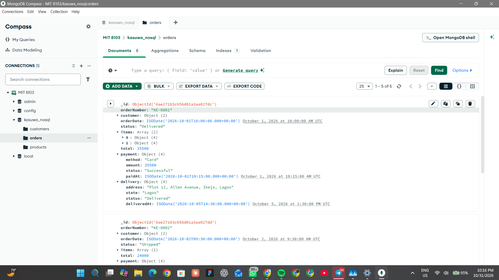
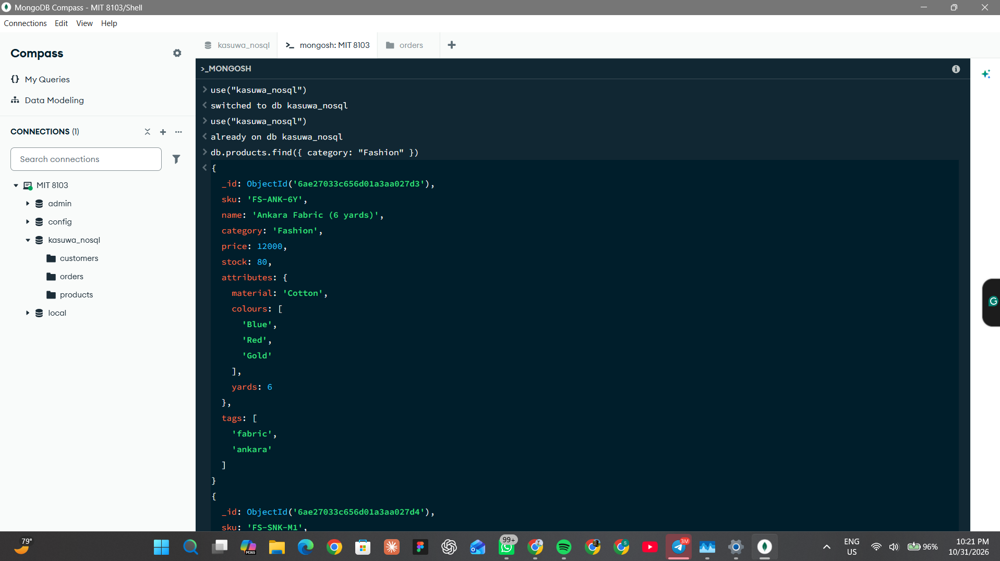
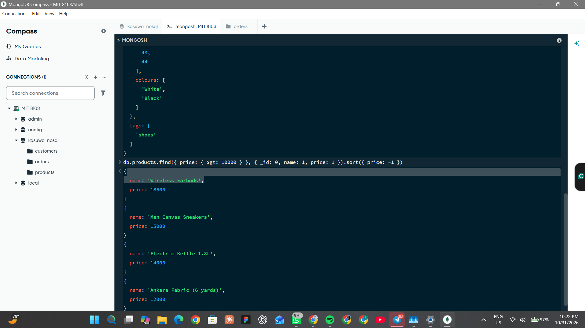
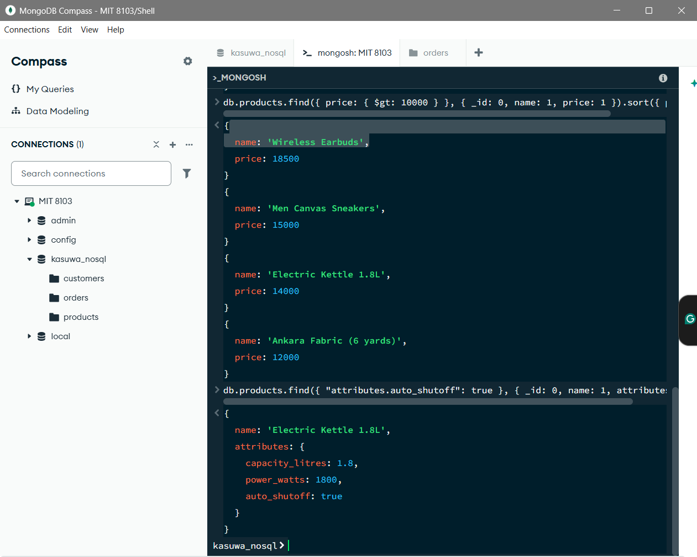
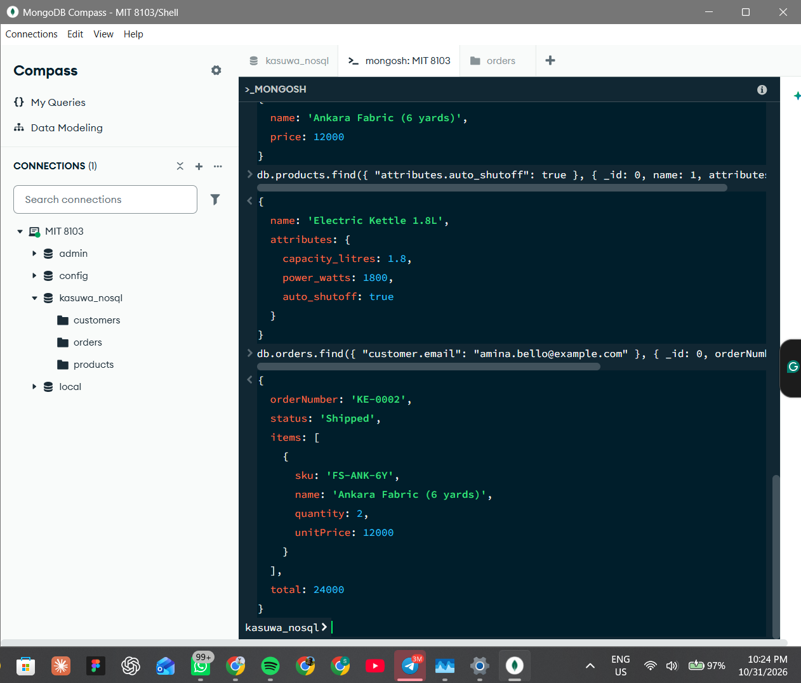
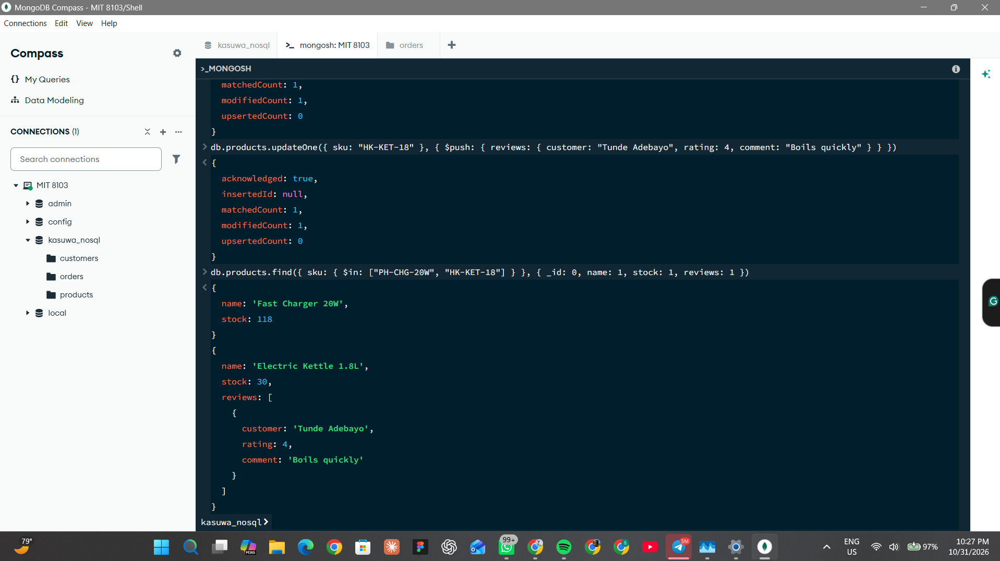
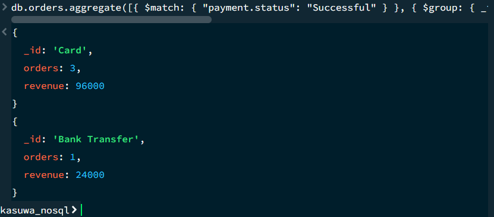
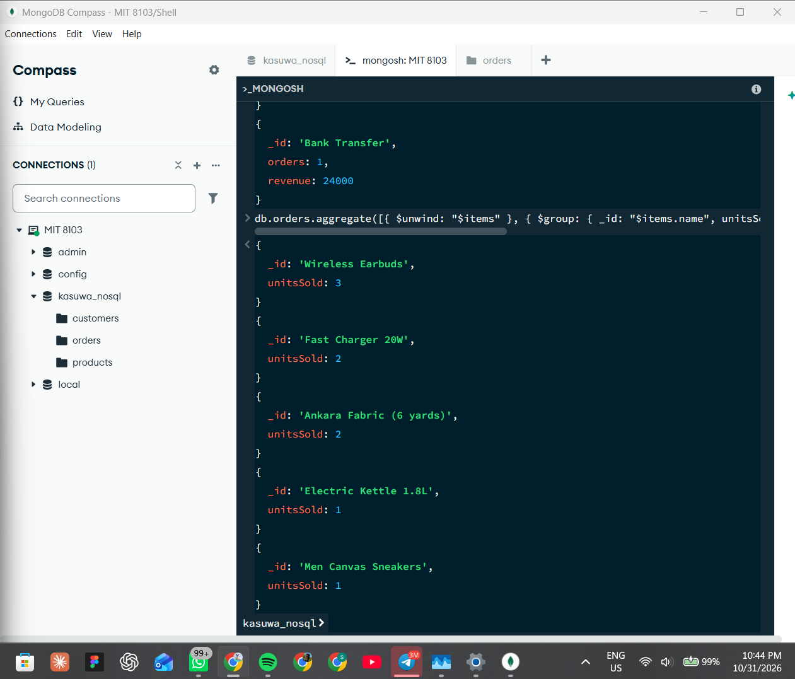
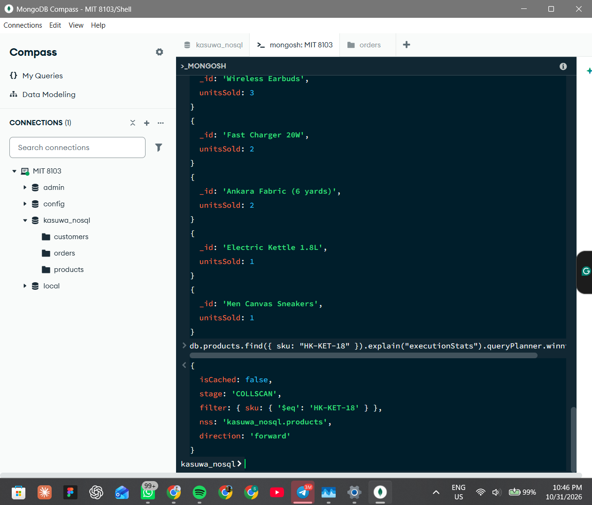
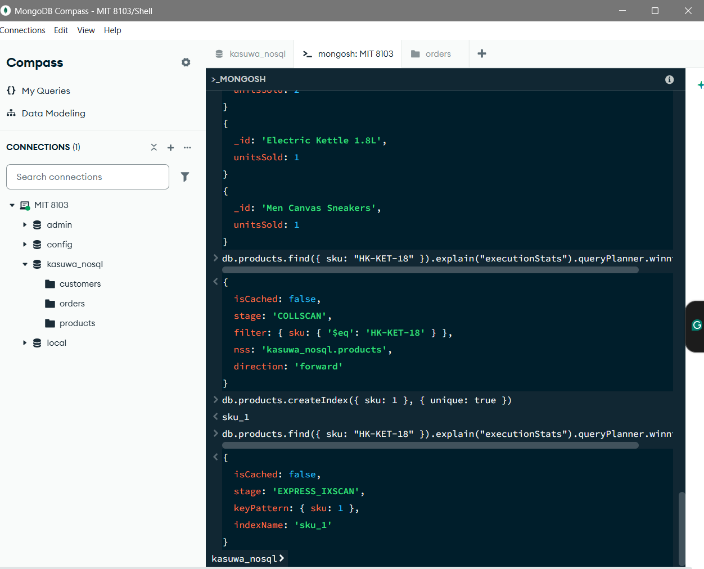

# Portfolio 4: NoSQL and Advanced Data Models

## Case study
Kasuwa Express, a fictional Nigerian online store (see the main README).

## Files in this folder
- insert_data.js: creates the collections and inserts the sample data
- queries.js: the queries, updates, aggregations and index used
- screenshots/: evidence of each step

## Chosen NoSQL model: document database (MongoDB)
MongoDB stores data as documents (JSON-like objects) grouped into collections.
I used the database kasuwa_nosql with three collections: products, customers
and orders.

## How the relational design was converted
| PostgreSQL (Portfolio 1) | MongoDB | Reason |
|---|---|---|
| categories | a category field inside each product | A category is only a name, so it does not need its own collection |
| products | products collection | Each product carries its own flexible attributes |
| customers | customers collection | Each customer has an addresses list inside the document |
| orders, order_items, payments, deliveries | orders collection (one document per order) | These are always read together, so they are nested inside the order |

In PostgreSQL an order was spread over four tables and needed joins. In
MongoDB one document holds the customer, the items, the payment and the
delivery, so a single read returns the whole order.

## Implementation
I inserted 6 products, 5 customers and 5 orders.

### Finding and filtering
- Query 1 found products in the Fashion category.
- Query 2 found products costing more than 10,000, sorted by price.

The screenshot is in two parts because the output was long.

### Flexible attributes
Different products store different attributes (a kettle has auto_shutoff, a
sneaker has sizes). I searched inside the nested attributes with
"attributes.auto_shutoff": true.

### Reading a whole order
One query on customer.email returned the whole order including its items.

### Updating documents
A sale reduced the stock of the Fast Charger with $inc. After the update its
stock was 118. A customer review was added to the Electric Kettle with $push.

### Aggregation
- Revenue by payment method: Card had 3 successful orders worth 96000, and
  Bank Transfer had 1 order worth 24000.
- Best-selling product: Wireless Earbuds, with 3 units sold. $unwind was
  used to split each order into one row per item before adding up.

### Indexing
Before the index, a search by sku used a COLLSCAN (every document was read).
After I created a unique index on sku, the plan used an index scan (IXSCAN)
on the sku_1 index, so MongoDB went straight to the matching document.

## Why a document database suits this case study
- Products have different attributes by category. A document can hold exactly
  the attributes a product needs, without empty columns or constant schema
  changes.
- An order is always read as a whole (customer, items, payment, delivery).
  Storing it as one document makes that read fast and simple.
- A shop must scale for busy periods. MongoDB can spread data across servers
  (sharding), which is covered in Portfolio 5.
- Customer addresses and product reviews are lists that grow, which fit
  naturally as arrays inside documents.

## Trade-offs
- Data is duplicated. For example, the customer name and the product price at
  purchase time are copied into each order. This keeps old orders accurate but
  means a name change must be updated in several places.
- Joins across collections are less natural than in SQL.
- Strong multi-table consistency, such as the transactions in Portfolio 3, is
  easier in PostgreSQL. For payments and stock control the relational design
  is the safer choice.
- Overall, a mix could be used: PostgreSQL for payments and stock, and
  MongoDB for the product catalogue and order history.

## Other NoSQL types (for context)
A key-value store such as Redis could hold shopping carts and login sessions.
A graph database such as Neo4j could power "customers who bought this also
bought" recommendations.
