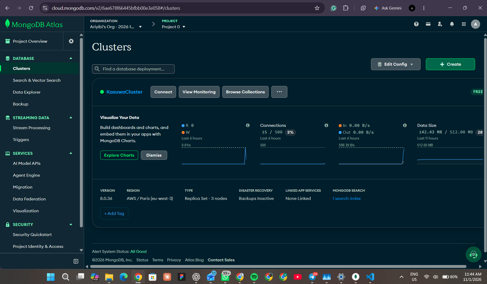
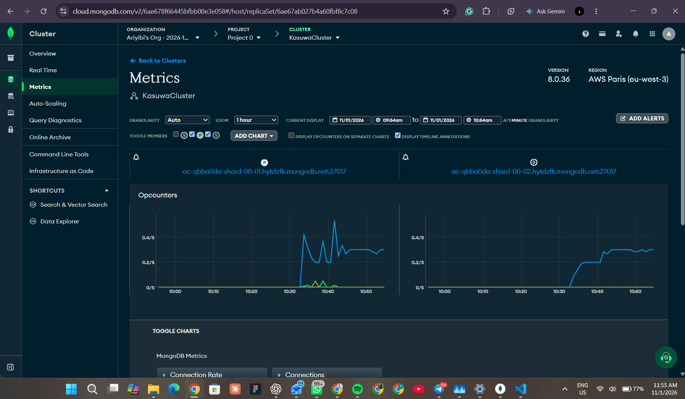
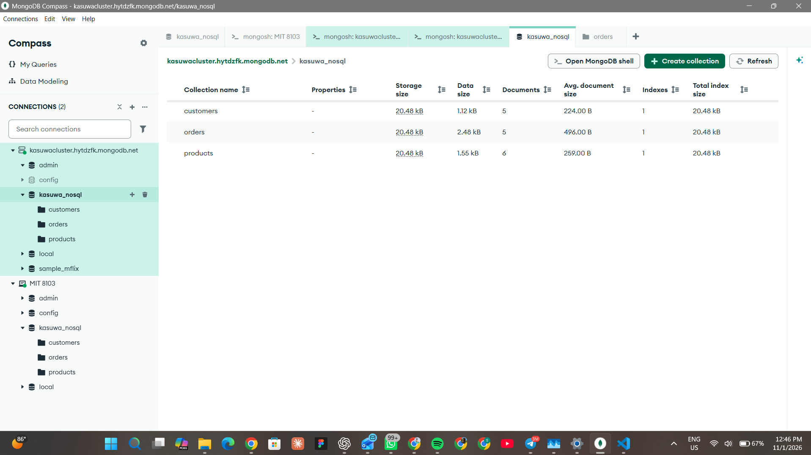
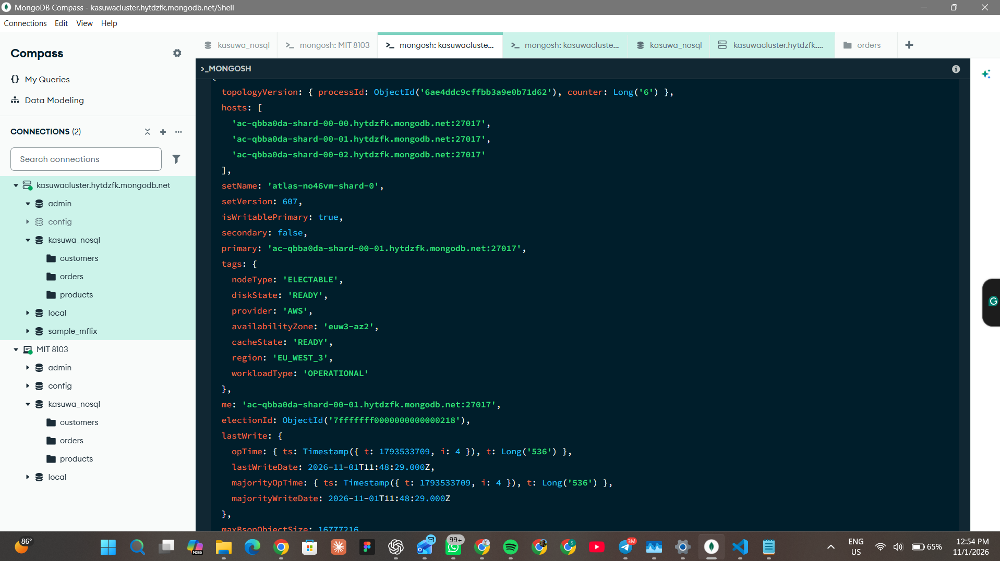
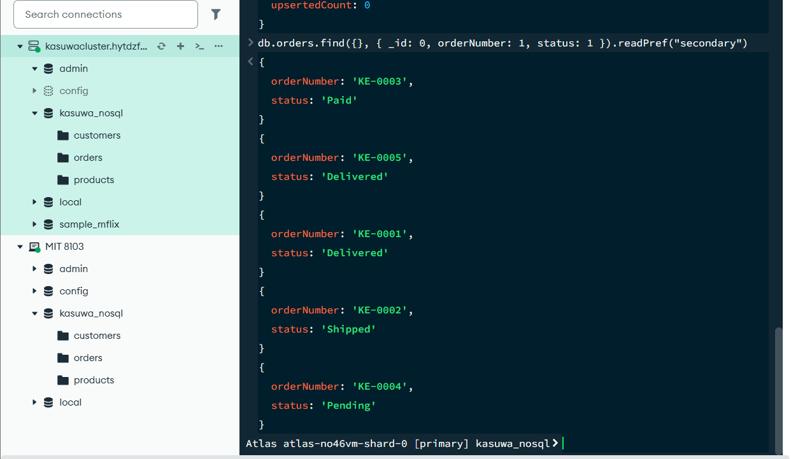
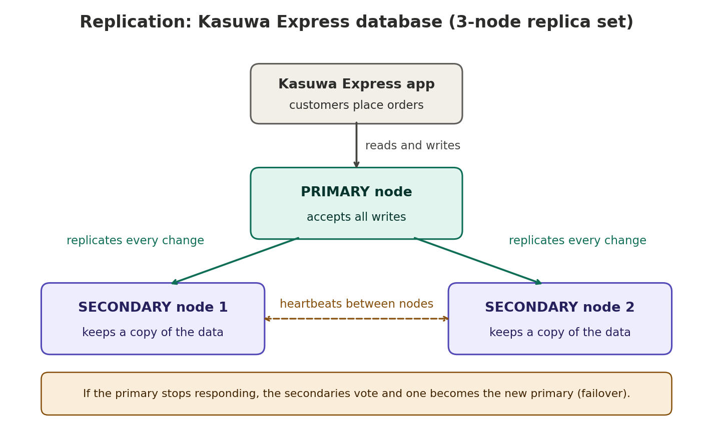
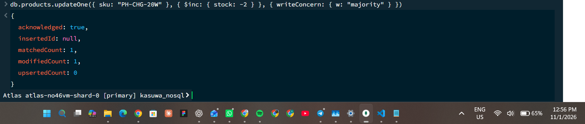
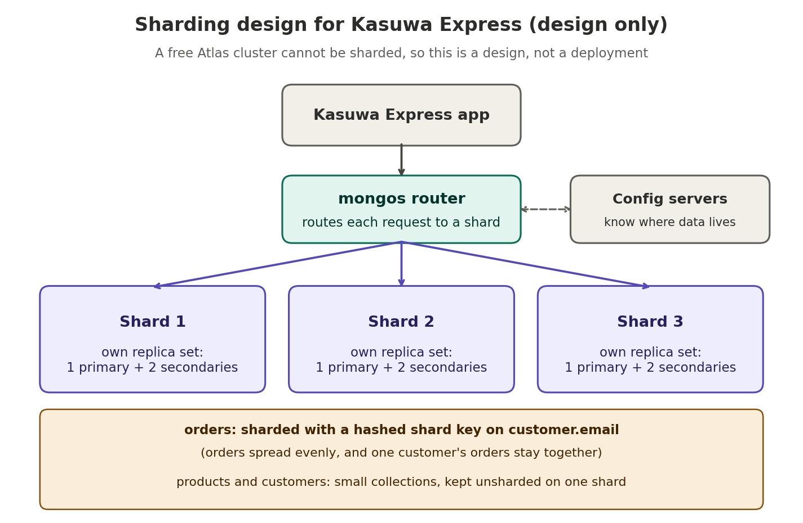

# Portfolio 5: Distributed and Cloud Database Exercise

## Case study
Kasuwa Express, a fictional Nigerian online store (see the main README).

## Files in this folder
- commands.js: the commands run on the cloud database
- replication-diagram.png and sharding-design.png: design diagrams
- screenshots/: deployment and replication evidence

## 1. Cloud deployment
I deployed the Kasuwa Express document database (the collections from
Portfolio 4) to MongoDB Atlas, a managed cloud database service. I used a free
cluster named KasuwaCluster hosted on AWS/Paris (eu-west-3).

Steps taken:
1. Created a free Atlas cluster.
2. Atlas created a database user and added my computer's IP address to the
   network access list, so only my computer could connect.
3. Connected with MongoDB Compass using the connection string.
4. Loaded the products, customers and orders collections.

The connection string and password are not stored in this repository.

## 2. Replication
Atlas runs every cluster as a replica set. My free cluster has 3 nodes: one
primary that accepts all writes, and two secondaries that keep copies of the
data. Every change made on the primary is copied to the secondaries.

The command db.hello() shows the replica set name ('atlas-no46vm-shard-0'), the three
nodes and which one is primary.

I also read the orders collection from a secondary node with
readPref("secondary"). All 5 orders were returned, which shows that the data
was replicated.

Why replication matters for Kasuwa Express:
- Availability: if the primary fails, the secondaries vote and one becomes
  the new primary, so the shop keeps taking orders after a short pause.
- Durability: the data exists on more than one server, so one server failing
  does not lose orders.
- Read capacity: product browsing could be read from the secondaries so that
  the primary can focus on orders and payments.

Limitation: free Atlas clusters do not allow a primary failover test, so I
could not demonstrate a failover. I describe the expected behaviour above.

## 3. Consistency and availability
A distributed database must balance consistency (everyone sees the same, latest
data) against availability (the system keeps answering). This trade-off is
described by the CAP theorem. By default MongoDB favours consistency: all
writes go to the single primary. During a failover there is a short period
(seconds) with no primary, so writes pause until a new primary is elected.

Two settings control the balance:
- Write concern. I ran a write with w: "majority". MongoDB only reports success
  once most of the nodes have the change, so a confirmed payment cannot be
  lost if the primary fails straight afterwards. It is slightly slower.

- Read preference. Reading from a secondary spreads the load, but a secondary
  can lag a little behind the primary, so a read might return slightly old
  data (eventual consistency).

Choices for Kasuwa Express:
| Operation | Setting | Reason |
|---|---|---|
| Placing an order and recording a payment | write concern majority, read from primary | Money and stock must never be lost or stale |
| Browsing the product catalogue | read from a secondary | A few seconds of delay is acceptable and it reduces load |
| Order history page | read from a secondary or primary | Slightly old data is acceptable |

## 4. Sharding (design)
Replication copies the same data to every node. Sharding splits the data across
several servers, so that no single server has to store or handle everything. It
is used when data or traffic grows beyond what one replica set can handle, for
example during big sales events.

A free Atlas cluster cannot be deployed as a sharded cluster, so I present a
design instead of a deployment.

How it would work: the application talks to a mongos router, which uses
information from the config servers to send each request to the correct shard.
Each shard is its own replica set.

Shard key design for the orders collection:
- Chosen key: a hashed customer.email.
- Why: hashing spreads orders evenly across shards, and all orders for one
  customer stay together, so "show my orders" goes to one shard.
- Rejected: orderDate. New orders always have the newest date, so every new
  order would land on the same shard (a hot shard).
- Rejected: status. It has only a few values (Pending, Paid, Shipped, and so
  on), so the data could not be split into many pieces.
- Trade-off: queries that do not include customer.email, such as total sales
  per state, must ask every shard and combine the answers, which is slower.

The products and customers collections are small, so they would not be sharded.

## 5. What about the relational database?
The payments and stock data in PostgreSQL (Portfolio 1 to 3) can be made
available in a similar way with a primary server and one or more read replicas
that copy its data. Sharding PostgreSQL is harder and normally needs extra
tools, which is one reason a document database is easier to scale out.

## 6. Cloud considerations
- A managed service such as Atlas creates the servers, replication and
  security setup for me, which saves time and reduces mistakes.
- Security: access needs a database user and password, only allowed IP
  addresses can connect, and the connection is encrypted. Passwords must never
  be committed to GitHub.
- Location: the cloud region affects how fast the shop feels for customers in
  Nigeria. A region close to Nigeria gives lower delay.
- Data protection: a real shop storing Nigerian customers' personal data should
  check the data protection rules about where the data is stored.
- Cost: the free tier is for learning. A real shop would need a paid cluster
  for more storage, backups, failover testing and sharding.
